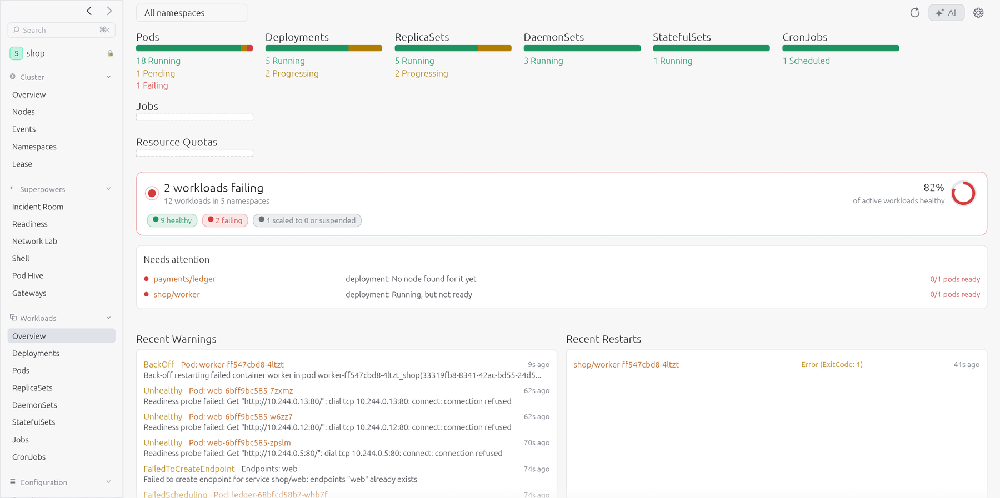
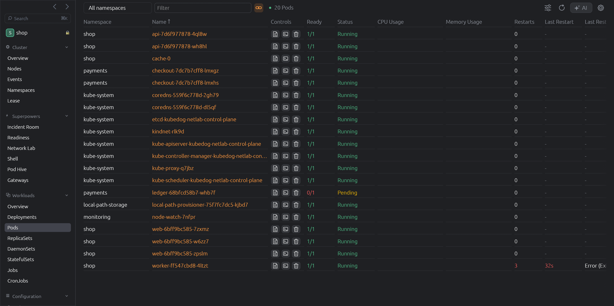
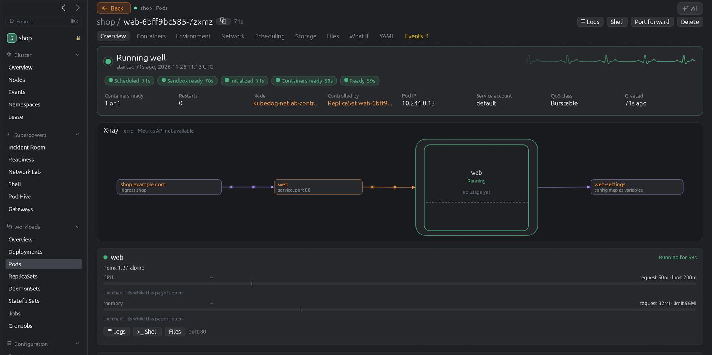
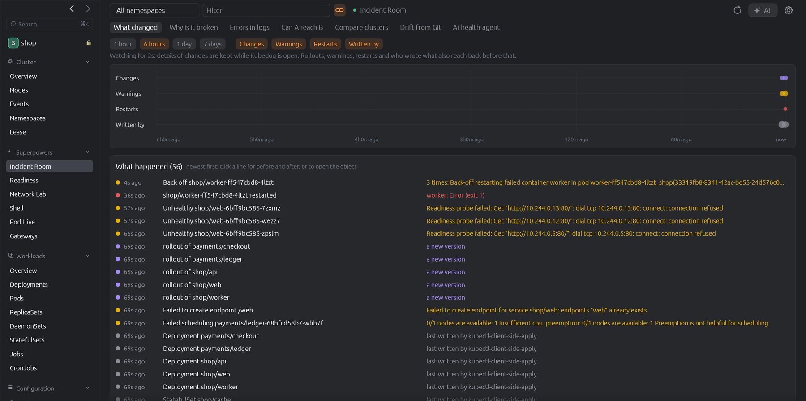

# Kubedog


A fast desktop app for Kubernetes clusters, for macOS, Windows and Linux. It talks to clusters through your own
`kubectl`, so it works with whatever your kubeconfig can reach, and it never changes a cluster without asking.



## Why Kubedog

- **See what's wrong first.** Every page starts with what is, then why, then what to do: "2 workloads failing", "No
  node found for it yet".
- **Every cluster starts protected.** Nothing is scaled, deleted or restarted until you unlock that cluster and
  confirm, and the confirmation says which cluster it acts on.
- **Several clusters side by side**, each with its own colour in every list.
- **Superpowers for what runs in a cluster:** Argo CD, OpenShift, Postgres, Elasticsearch, Proxmox and more get
  pages of their own, found by themselves.
- **Works without internet.** Nothing is downloaded after installing, there's no update check and no statistics.
- **AI help only if you want it.** It's off until you switch it on, and you decide what may be sent and where.

Everything it does is in [docs/FEATURES.md](docs/FEATURES.md).

## A look around

| | |
|---|---|
|  Lists of every kind, with filters, columns you choose and actions on each row. |  A pod's page: whether it's well, what it talks to, and how it came up. |



The Incident Room: what changed in the cluster, newest first. The pictures show a made-up cluster.

## Install

You need `kubectl` (or OpenShift's `oc`) on your `PATH`; the Windows installer brings one along.

### macOS (Apple silicon)

Download `kubedog-<version>-macos-arm64.dmg` from [Releases](https://github.com/pezzking/kubedog/releases), open it and drag Kubedog to
Applications. It's signed and checked by Apple (notarized), so it opens without a warning, also on a Mac without
internet.

Or, with Homebrew, the same app:

```sh
brew install --cask pezzking/tap/kubedog-app
```

To update: `brew upgrade --cask kubedog-app`.

### Linux

Download `kubedog-<version>-linux-amd64.tar.gz` (or `-arm64`) from [Releases](https://github.com/pezzking/kubedog/releases), then:

```sh
tar xzf kubedog-*-linux-*.tar.gz
sudo install kubedog-*/kubedog /usr/local/bin/
kubedog
```

It needs a desktop (X11 or Wayland) with OpenGL or Vulkan, and glibc 2.28 or newer (Debian 10, Ubuntu 18.10,
RHEL 8 and later).

### Windows

Download `kubedog-<version>-windows-setup.exe` from [Releases](https://github.com/pezzking/kubedog/releases) and run it. It's one file for every
64-bit Windows computer (Intel, AMD or ARM) and installs the program that fits. It installs for you alone, without an
administrator, and adds Kubedog to the Start menu; remove it again under Settings > Apps > Installed apps.

Windows may say the publisher is unknown: the program isn't signed yet. Choose "More info", then "Run anyway".

Kubedog reaches clusters through `kubectl`. It uses yours when you have one (or OpenShift's `oc`); the installer
brings a `kubectl` along for computers that have none.

Without installing: the `.zip` files hold the same `kubedog.exe`, without `kubectl`. Take `-x64` for Intel or
AMD (nearly every PC) and `-arm64` for an ARM computer such as a Snapdragon laptop; the wrong one gives "This app can't run on your PC".

### macOS, the program alone

`kubedog-<version>-macos-arm64.tar.gz` holds the program without the app around it, also signed and checked by
Apple:

```sh
tar xzf kubedog-*-macos-arm64.tar.gz
./kubedog-*/kubedog
```

Apple's answer can't be fixed to a program alone, so a Mac asks Apple the first time it's started. Without
internet, take the `.dmg`.

## First start

1. Open Kubedog. The start page lists every cluster from your kubeconfig files (`KUBEDOGCONFIG`, then `KUBECONFIG`,
   then `~/.kube/config`); more files can be added in the app.
2. Click a cluster to open it. It's protected: you can look at everything, and nothing can be changed.
3. To change something, click the lock next to the cluster's name and confirm.

No `kubectl` on the computer? The first page says so and how to install it, and offers a made-up sample cluster to
look around in. Optional extras: `helm` for the Helm page, the `kubectl cnpg` plugin for live Postgres state, `curl`
for Elasticsearch and Pulsar.

## Without internet (air-gapped)

Nothing is downloaded while installing or afterwards, and Kubedog never calls home: no update check, no
statistics. Its AI help is off until you switch it on, and can be pointed at a model inside your own network.

- **Windows:** carry `kubedog-<version>-windows-setup.exe` and `SHA256SUMS` inside. The installer
  holds everything, `kubectl` included, and needs no administrator.
- **macOS:** carry the `.dmg` and `SHA256SUMS` inside. Apple's check travels inside it, so it opens without asking
  Apple. `kubectl` or `oc` has to be on the computer already.
- **Linux:** carry the `.tar.gz` and `SHA256SUMS` inside and install by hand as above. `kubectl` or `oc`
  has to be on the computer already.

Check the file after carrying it over, as below.

## Check a download

Every release has a `SHA256SUMS` file:

```sh
shasum -a 256 -c SHA256SUMS --ignore-missing
```

## How well each system is tried

| System | State |
|---|---|
| macOS, Apple silicon | Built and used daily |
| Linux, amd64 and arm64 | Built, and seen to start on Debian 11; its window hasn't been looked at yet. Some parts are still written for macOS (opening an outside terminal app, the file chooser) |
| Windows, amd64 and arm64 | Built, **not yet tried on a Windows computer**. Expect rough edges; the built-in shell and outside terminals are written for macOS |

## Where your settings are kept

One file, `prefs.json`, in `~/Library/Application Support/Kubedog` (macOS), `~/.config/kubedog` (Linux) or
`%APPDATA%\Kubedog` (Windows). Kubeconfigs added by pasting go into a `kubeconfigs` folder next to it, readable only
by you. Logins (Grafana, Proxmox, Elasticsearch, AI keys) are kept in memory or the system's keychain, never in
that file. Your own kubeconfig files are only changed when you delete a context from the start page, after a
confirmation.

## Building it yourself

```sh
cargo run
```

More in [docs/DEVELOPING.md](docs/DEVELOPING.md): building, tests, where things are in the code, making a release.

## Licence

Apache License 2.0, see [LICENSE](LICENSE). What Kubedog is built with, and began from, is in
[THIRD-PARTY.md](THIRD-PARTY.md); notices for the libraries come with every download.
